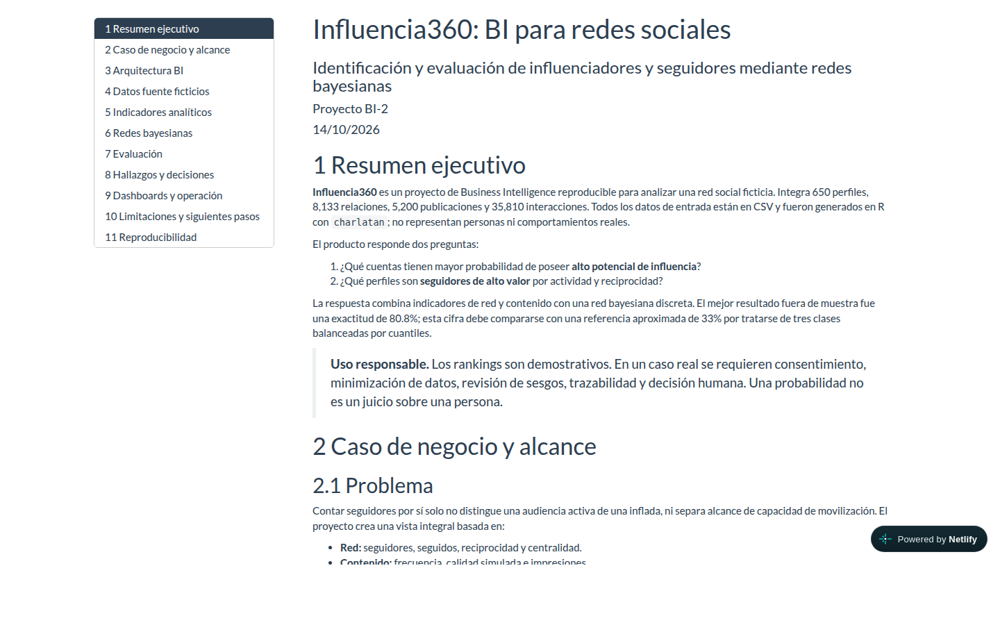
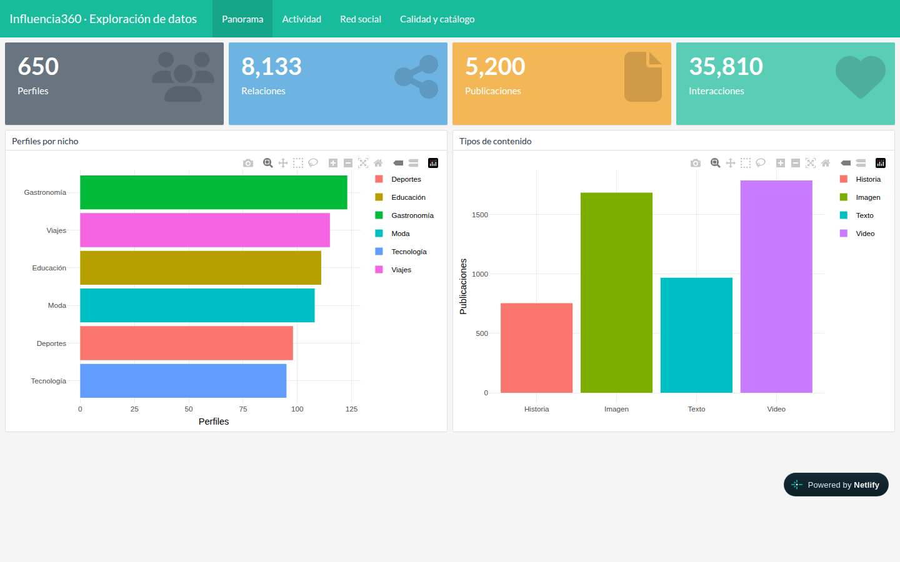
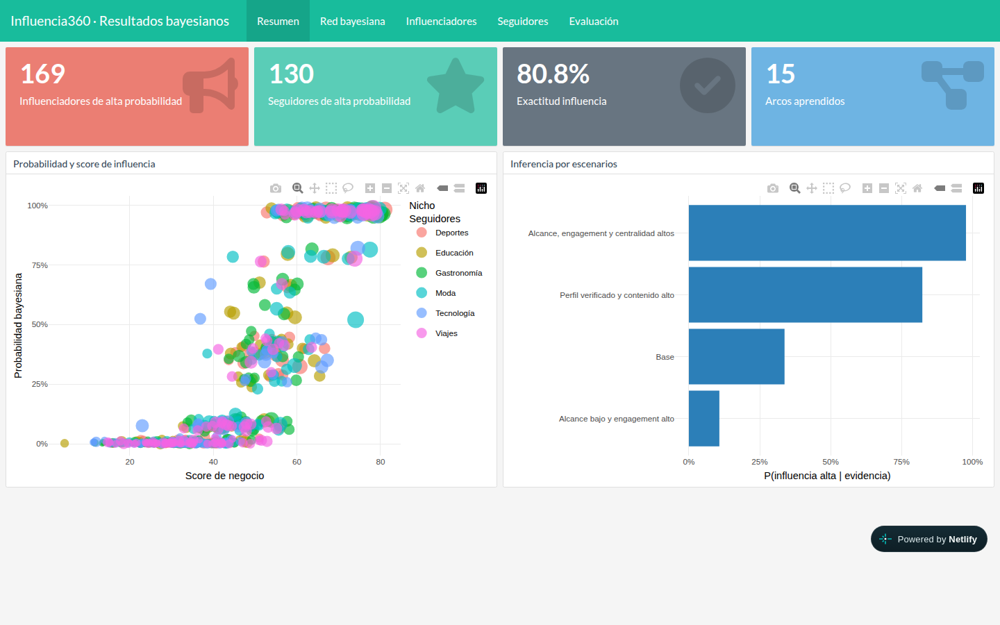

# U3-T1 · Publicación en Internet del proyecto *Influencia360* con Netlify

- **Estudiante:** David Andres Quintela Saavedra
- **Materia:** Business Intelligence II
- **Fecha de entrega:** 16/10/2026
- **Repositorio original:** <https://github.com/rubendcl/Influencers>
- **Repositorio propio (fork):** <https://github.com/dq-datasci/Influencers>
- **Sitio publicado:** <https://influencia360-dq.netlify.app>
- **Servicio elegido:** Netlify (plan *Free*, modelo de créditos)
- **Equipo:** Windows + WSL2 (Linux 6.6), R 4.5.3, Node.js 24.22.0, Netlify CLI 27.12.1, Google Chrome (headless, para capturas)

## Contenido de esta carpeta

| Ruta | Contenido |
|---|---|
| `INFORME.md` | Este documento (fuente en Markdown) |
| `INFORME.pdf` | El mismo informe en PDF, con las capturas incrustadas |
| `capturas/` | Capturas de los tres reportes publicados en Netlify |
| `logs/run_all.log` | Salida de la ejecución local del *pipeline* en R |
| `logs/netlify_deploy.log` | Salida del despliegue a producción con Netlify CLI |
| `logs/verificacion_http.txt` | Códigos HTTP, cabeceras y tamaños comprimidos de las páginas publicadas |
| `logs/sitio_netlify.json` | Configuración del sitio leída desde la API de Netlify |

---

## 1. Recreación local del proyecto

### 1.1 Repositorio en la cuenta propia de GitHub

El repositorio se bifurcó (*fork*) a la cuenta `dq-datasci` y se clonó localmente. El remoto
`upstream` sigue apuntando al repositorio del docente para poder traer cambios:

```bash
gh repo fork rubendcl/Influencers --clone=false
gh repo clone dq-datasci/Influencers ~/Projects/Influencers
# origin   -> git@github.com:dq-datasci/Influencers.git
# upstream -> git@github.com:rubendcl/Influencers.git
```

### 1.2 Qué es el proyecto

*Influencia360* es un proyecto de BI en R que genera con `charlatan` una red social **ficticia**
(perfiles, relaciones, publicaciones e interacciones), calcula indicadores analíticos y entrena una
**red bayesiana discreta** (`bnlearn`) para estimar qué cuentas tienen alto potencial de influencia y
qué perfiles son seguidores de alto valor. El script `run_all.R` ejecuta todo el *pipeline* y
renderiza tres documentos HTML autocontenidos en `docs/`:

| Archivo | Reporte | Tipo |
|---|---|---|
| `docs/index.html` | Informe metodológico y ejecutivo | R Markdown (`html_document`) |
| `docs/dashboard_datos.html` | Exploración interactiva de los datos | `flexdashboard` + `plotly`/`DT`/`visNetwork` |
| `docs/dashboard_resultados.html` | Ranking, red bayesiana y escenarios de inferencia | `flexdashboard` + `plotly`/`DT`/`visNetwork` |

### 1.3 Dependencias e incidencia encontrada

Las dependencias se instalaron en una librería local del proyecto (`.Rlib/`, ya prevista en
`.Rprofile` e ignorada por git), usando los binarios de Posit Package Manager para Ubuntu 24.04:

```r
install.packages(c("charlatan","bnlearn","dplyr","tidyr","readr","ggplot2","plotly",
                   "DT","visNetwork","flexdashboard","rmarkdown","knitr"), lib = ".Rlib")
```

**Incidencia:** con solo esas dependencias (las que lista el README y valida `run_all.R`), el
*pipeline* falla al renderizar el informe:

```text
Error in `library()`: there is no package called 'DiagrammeR'
Quitting from informe_proyecto.Rmd:17-37 [setup]
```

Los tres `.Rmd` de `reports/` usan además **`DiagrammeR`** (diagrama de arquitectura) y
**`scales`**, que no están declarados. Se instalaron y la ejecución completó sin errores.

### 1.4 Ejecución

```bash
Rscript run_all.R      # ~21 s
```

```text
Datos generados: 650 perfiles, 8133 relaciones, 5200 publicaciones y 35810 interacciones.
Control de calidad: 12 de 12 pruebas aprobadas.
Modelo generado con 15 arcos; exactitud influencia = 0.808.
Generado: docs/index.html
Generado: docs/dashboard_datos.html
Generado: docs/dashboard_resultados.html
Pipeline completo. Abra docs/index.html
```

Gracias a la semilla fija (`20260917`) los CSV de `data/raw` y `data/processed` resultaron
**idénticos** a los del repositorio original (git no detectó cambios); solo cambiaron los HTML
(fecha de generación). Log completo en `logs/run_all.log`.

---

## 2. Publicación en Netlify

### 2.1 Configuración agregada al repositorio

Los reportes ya son HTML estáticos, por lo que no hace falta ningún paso de *build*: basta con
indicarle a Netlify que publique la carpeta `docs/`. Se agregó `netlify.toml` en la raíz
(y, como alternativa, un `vercel.json` equivalente):

```toml
# Publicación estática de los reportes HTML generados por run_all.R
[build]
  publish = "docs"
  command = ""

[[headers]]
  for = "/*.html"
  [headers.values]
    Cache-Control = "public, max-age=0, must-revalidate"
    X-Robots-Tag = "noindex"
```

- `Cache-Control … must-revalidate`: el navegador siempre comprueba si hay una versión nueva del
  reporte (la CDN de Netlify igual lo sirve desde caché e invalida automáticamente en cada *deploy*).
- `X-Robots-Tag: noindex`: los reportes son académicos y con datos sintéticos; se pide a los
  buscadores no indexarlos.

Commit `050938a` en el fork: *“build: add Netlify/Vercel config to publish docs/ and regenerate reports”*.

### 2.2 Despliegue

Se usó **Netlify CLI** (instalado con Node.js en el directorio de usuario):

```bash
netlify login                                    # autorización OAuth en el navegador
netlify sites:create --name influencia360-dq --account-slug dq-datasci
netlify link --id a6db2da0-fec0-45d7-8634-5785b9a23f93
netlify deploy --prod --dir docs --message "Influencia360 - reportes BI II"
```

```text
✔ Finished uploading 4 assets
✔ Deploy is live!
Production URL:   https://influencia360-dq.netlify.app
Unique deploy URL: https://6ad1ea33556d3dac0318a50d--influencia360-dq.netlify.app
```

> **Nota WSL:** `netlify login` intenta abrir un navegador y en WSL se queda esperando sin mostrar
> nada. Se resolvió ejecutándolo con `BROWSER=echo`, que imprime el enlace de autorización para
> abrirlo manualmente en Windows.

### 2.3 Hallazgo: el sitio nació **privado**

Inmediatamente después del primer *deploy*, las tres páginas respondían **HTTP 401** y redirigían a
`app.netlify.com/edge-access` (inicio de sesión de Netlify). La API mostraba `sso_login: true`.

Según la documentación de *Project visibility*, los equipos creados desde el 28/07/2026 tienen como
valor por defecto **“Private for new projects”**, y en el plan Free un proyecto privado **solo lo
puede ver el Team Owner**. Se cambió la visibilidad a pública (equivale a *Project configuration →
General → Visitor access → Project visibility → Public*):

```bash
netlify api updateSite --data '{"site_id":"a6db2da0-…","body":{"sso_login":false}}'
```

Tras el cambio, las tres páginas responden **HTTP 200** sin necesidad de un nuevo *deploy*.

### 2.4 Reportes publicados (3)

| Reporte | URL |
|---|---|
| Informe ejecutivo | <https://influencia360-dq.netlify.app/> |
| Dashboard de datos | <https://influencia360-dq.netlify.app/dashboard_datos> |
| Dashboard de resultados | <https://influencia360-dq.netlify.app/dashboard_resultados> |







### 2.5 Verificación (`logs/verificacion_http.txt`)

| Comprobación | Resultado |
|---|---|
| Estado de las 3 páginas | `HTTP/2 200` |
| `http://…` | `301` → `https://…` (HTTPS forzado) |
| HSTS | `strict-transport-security: max-age=31536000; includeSubDomains; preload` |
| Cabeceras de `netlify.toml` | `cache-control` y `x-robots-tag: noindex` aplicadas |
| URL sin `.html` (`/dashboard_resultados`) | `200` (*pretty URLs*) |
| Compresión | Brotli (`content-encoding: br`) |

| Archivo | Tamaño original | Transferido (Brotli) | Reducción |
|---|---:|---:|---:|
| `index.html` | 8,69 MB | 2,47 MB | 72 % |
| `dashboard_datos.html` | 10,07 MB | 3,85 MB | 62 % |
| `dashboard_resultados.html` | 10,09 MB | 3,87 MB | 62 % |

---

## 3. Características básicas de la publicación en Netlify

1. **Hosting estático en una CDN global.** Los HTML se suben una vez y se distribuyen desde los
   nodos de borde de Netlify; no hay servidor que administrar. Para reportes R Markdown /
   flexdashboard autocontenidos, es el caso de uso ideal.
2. **Configuración declarativa (`netlify.toml`).** Carpeta publicada, comando de *build*,
   cabeceras HTTP, redirecciones y reglas por ruta quedan versionadas junto al código.
3. **Despliegues atómicos e inmutables.** Cada *deploy* tiene su propia URL permanente
   (`<id>--influencia360-dq.netlify.app`); la URL de producción solo cambia cuando el nuevo
   *deploy* está completo, y se puede **volver a una versión anterior** con un clic (*rollback*).
4. **HTTPS automático** con certificado gratuito, redirección 301 y HSTS sin configuración.
5. **Compresión automática** (Brotli/gzip): los dashboards de ~10 MB viajan como ~3,9 MB.
6. **Tres formas de desplegar:** arrastrar la carpeta `docs/` en el panel web (*Netlify Drop*),
   **CLI** (la usada aquí) o **despliegue continuo desde GitHub**: al conectar el repositorio, cada
   `git push` publica automáticamente y cada *pull request* genera un *Deploy Preview*.
7. **Plan Free con créditos:** 300 créditos/mes. Costos: *deploy* de producción 15 créditos,
   ancho de banda 20 créditos/GB, 2 créditos por cada 10 000 solicitudes. Sin tarjeta de crédito.
8. **Visibilidad configurable** (pública / privada), con proyectos nuevos privados por defecto en
   equipos recientes (ver §2.3). En el plan Free Netlify inyecta un script (`/.netlify/scripts/hud`, `data-account-tier="free"`)
   que muestra la insignia “Powered by Netlify” en las páginas.

---

## 4. Opciones de Netlify para cada necesidad

### 4.1 Una dirección de Internet cualquiera — ¿es la solución por defecto?

**Sí.** Todo proyecto recibe automáticamente un subdominio gratuito
`<nombre-proyecto>.netlify.app` con HTTPS. Si no se indica nombre, Netlify genera uno aleatorio
(p. ej. `jolly-panda-12ab34.netlify.app`); aquí se eligió `influencia360-dq`. El nombre se puede
cambiar en *Project configuration → Change project name*. Además, cada *deploy* tiene su
**URL única e inmutable**, útil para compartir una versión concreta de un reporte.

### 4.2 Una dirección específica o de la empresa

Se maneja **dentro de Netlify**, incluso en el plan Free (dominios personalizados y SSL incluidos
en todos los planes), en *Domain management → Add a domain*. Tres opciones:

| Opción | Cómo | Cuándo conviene |
|---|---|---|
| **DNS externo** (el de la empresa) | En el proveedor DNS actual: `CNAME reportes.empresa.com → influencia360-dq.netlify.app`. Para el dominio raíz: registro `ALIAS`/*CNAME flattening* a `apex-loadbalancer.netlify.com` o `A 75.2.60.5` | La empresa ya tiene su DNS (correo, otros sistemas) y TI no quiere moverlo. Lo típico para un subdominio `reportes.` o `bi.` |
| **Netlify DNS** | Se delegan los *nameservers* del dominio a Netlify | Certificados automáticos (incl. *wildcard*), subdominios por rama, todo en un panel |
| **Comprar el dominio en Netlify** | Registro directo desde el panel; DNS y SSL quedan configurados solos | Proyecto nuevo sin dominio propio |

En todos los casos Netlify emite y renueva el certificado HTTPS. La propagación DNS puede tardar
24–48 h (hasta 72 h).

### 4.3 Mucho volumen de información — ¿es un problema?

**Sí, es un tema a considerar**, por dos motivos distintos:

**a) Límites técnicos de archivos.** Netlify está pensado para sitios estáticos, no como
almacenamiento masivo. Recomienda archivos **≤ 10 MB** (los mayores no se cachean bien en la CDN)
y se reportan límites de ~54 000 archivos por directorio. **Los dos dashboards de este proyecto
(10,07 y 10,09 MB) ya están justo en ese umbral**, porque `flexdashboard` incrusta en el HTML todos
los datos y las librerías JavaScript (`plotly`, `DT`, `visNetwork`).

**b) Costo en créditos.** El ancho de banda cuesta 20 créditos/GB. Con los tamaños comprimidos
medidos, una visita que abre los tres reportes transfiere ~10,2 MB:

| Concepto | Cálculo | Resultado |
|---|---|---|
| Créditos disponibles tras 1 *deploy* | 300 − 15 | 285 |
| GB de tráfico que cubren | 285 / 20 | ≈ 14 GB/mes |
| Visitas completas (3 reportes) | 14 GB / 10,2 MB | ≈ 1 400 visitas/mes |
| Vistas de un solo dashboard | 14 GB / 3,9 MB | ≈ 3 600 vistas/mes |

Para una clase sobra; para distribuir a toda una empresa, no. Al agotar los créditos del plan Free
**el sitio se pausa** hasta el siguiente ciclo (en planes de pago, si no hay recarga automática).

**Opciones para resolverlo:**

- *Internas al proyecto:* renderizar con `self_contained: false` para que las librerías JS se
  compartan en `docs/lib/` y el navegador las cachee entre reportes; mover las tablas grandes
  (`DT`) a CSV/JSON cargados bajo demanda; agregar datos en R antes de graficar.
- *Internas a Netlify:* plan Personal (1 000 créditos) o Pro (3 000 créditos + recarga automática,
  1 500 créditos por 10 USD); **Netlify Blobs** para guardar datos fuera del *deploy*.
- *Externas:* dejar en Netlify solo el HTML “liviano” y servir los datos pesados desde un
  almacenamiento de objetos (Amazon S3, Cloudflare R2, Google Cloud Storage) o una API/base de
  datos; si el volumen es realmente grande (datos vivos, millones de filas), usar una herramienta
  de BI con servidor (Power BI Service, Posit Connect, Shiny) en lugar de HTML estático.

### 4.4 Información para usuarios específicos o con credenciales — ¿se maneja con estos servicios?

**Sí, pero depende del plan.** Se lo vio en la práctica: el sitio nació privado (§2.3).

| Mecanismo | Plan | Quién accede |
|---|---|---|
| **Private** (*Project visibility*) | Free / Personal | Solo el *Team Owner* (proyectos de un solo usuario): sirve para revisar, no para distribuir |
| **Private** con invitados | Pro | Miembros del equipo e invitados (ilimitados) con su cuenta de Netlify |
| **Password** (contraseña compartida) | Pro | Cualquiera que tenga la contraseña; se puede aplicar a producción y *previews* o solo a *previews* |
| **Team login / SSO (SAML) / controles globales** | Enterprise | Usuarios autenticados con el proveedor de identidad de la empresa (Okta, Azure AD…) |
| **Netlify Identity** + *role-based access control* (JWT + reglas de redirección por rol) | Según plan (verificar límites de usuarios) | Usuarios registrados por invitación; permite proteger rutas según rol (p. ej. `/gerencia/*`) |
| **Externo:** extensión **Auth0**, Supabase Auth, o un *Edge Function* que valide un token | Todos | Control fino de usuarios y roles con un proveedor de identidad externo |

Para reportes de BI con datos reales, la recomendación sería **Pro con contraseña** para algo
simple, o **SSO (Enterprise)** / **Auth0** si se necesitan usuarios individuales, auditoría y
revocación de accesos. Una contraseña compartida no identifica quién vio el reporte.

### 4.5 Dos características avanzadas de los planes de pago y cómo las usaríamos

**1. Protección por contraseña de producción y de *Deploy Previews* (plan Pro, 20 USD/mes).**
*Uso:* conectar el repositorio `dq-datasci/Influencers` para despliegue continuo. Cada cambio en
el modelo bayesiano se haría en una rama con *pull request*; Netlify generaría un *Deploy Preview*
protegido con contraseña donde el docente o el cliente revisa los dashboards nuevos **antes** de
fusionar a `main`. La versión de producción, si contuviera datos reales de clientes, quedaría
también tras contraseña, compartida solo con el área de marketing. En Pro, además, se puede
invitar a usuarios ilimitados a un proyecto privado.

**2. Analítica y métricas con 30 días de historial (plan Pro; *observability* de 1 día en Personal).**
*Uso:* medir la adopción de los reportes: cuántas visitas recibe cada dashboard, qué páginas se usan
más, desde qué países y con qué rendimiento de carga. Con eso se decidiría, por
ejemplo, si vale la pena optimizar `dashboard_resultados` (el más pesado) o si el informe
ejecutivo no se está leyendo. Al estar medida en el servidor, no requiere insertar código de
seguimiento en los HTML de R ni banners de cookies.

*Otras características de pago relevantes:* **SSO/SAML y SCIM** (Enterprise) para que solo los
empleados con cuenta corporativa vean los reportes; **Log drains** (Enterprise) para enviar los
registros de acceso a Datadog/Splunk y auditar quién consulta información sensible; más créditos
con **recarga automática** para evitar que el sitio se pause.

---

## 5. Conclusión

El proyecto *Influencia360* se recreó localmente desde el fork propio, se ejecutó el *pipeline*
completo (con la corrección de la dependencia no declarada `DiagrammeR`) y se publicaron sus
**tres** reportes en Netlify en <https://influencia360-dq.netlify.app>, con HTTPS, compresión y
cabeceras configuradas desde el propio repositorio. Netlify resuelve sin costo la URL por defecto
y el dominio corporativo; el **volumen** y el **acceso con credenciales** sí son temas que
dependen del plan: los dashboards autocontenidos de ~10 MB consumen créditos rápido, y la
protección para usuarios específicos requiere, como mínimo, el plan Pro.

## Fuentes

- Netlify — Pricing: <https://www.netlify.com/pricing/>
- Netlify Docs — Project visibility: <https://docs.netlify.com/manage/security/secure-access-to-sites/project-visibility/>
- Netlify Docs — Password protection: <https://docs.netlify.com/manage/security/secure-access-to-sites/password-protection/>
- Netlify Docs — Get started with domains: <https://docs.netlify.com/manage/domains/get-started-with-domains/>
- Netlify Docs — Role-based access control: <https://docs.netlify.com/manage/security/secure-access-to-sites/role-based-access-control/>
- Netlify Blog — Auth0 extension & Identity changes (actualizado 19/02/2026): <https://www.netlify.com/blog/auth0-extension-identity-changes/>
- Netlify Support Forums — límites de archivos por *deploy*: <https://answers.netlify.com/t/is-there-a-storage-or-file-count-limit-for-business-plan-hosting/118172>, <https://answers.netlify.com/t/what-is-the-maximum-allowed-object-size/145182/2>
- Netlify Support Forums — sitio pausado por créditos: <https://answers.netlify.com/t/my-site-was-paused-due-to-exceeded-credit-limit-even-though-i-have-low-bandwidth-and-build-usage/158348>

*Consultadas el 16/10/2026. Los planes y límites de Netlify cambian con frecuencia.*
